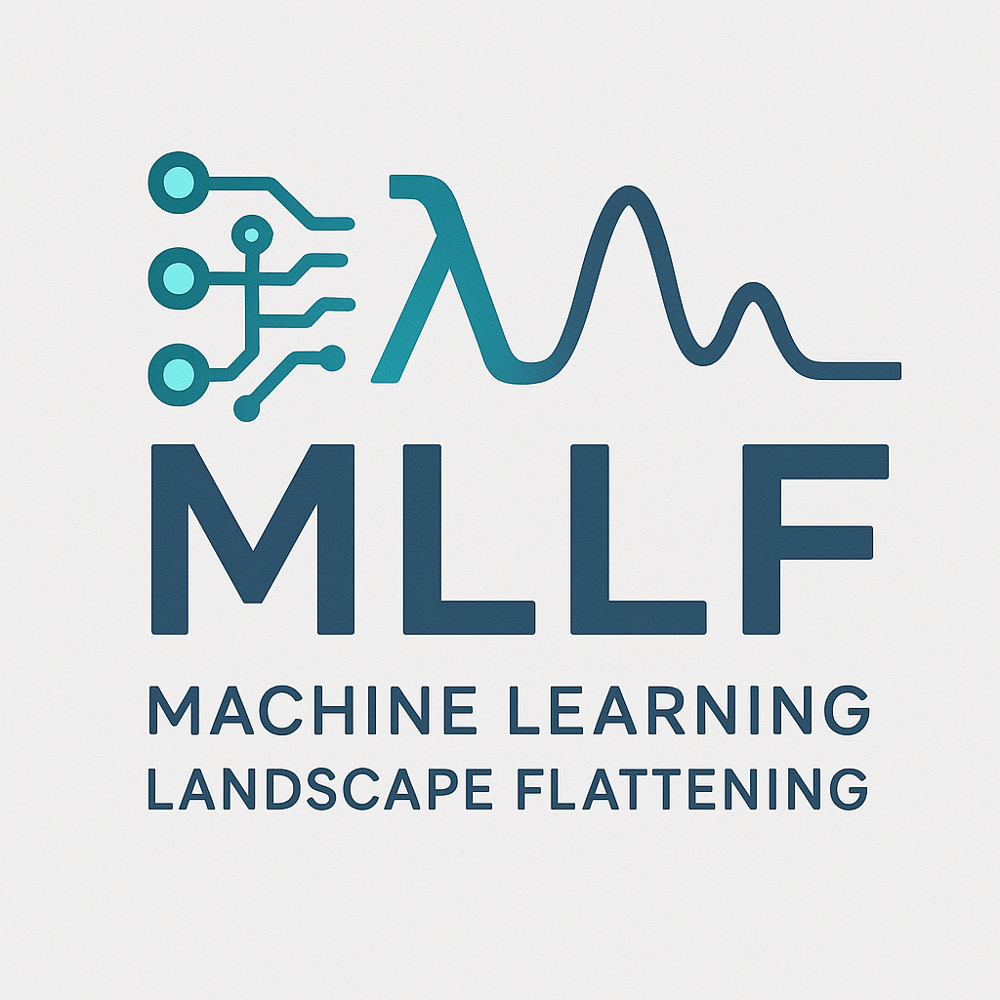

# mllf


Machine-learned landscape flattening: bias coefficients for multisite lambda dynamics,
pretrained on collected simulations and trained online against new ones.

## Installation

Recommended: create a virtual environment, install the package in editable mode with dev extras, and run tests.

Using venv:

```bash
python -m venv .venv
source .venv/bin/activate
pip install -e '.[dev]'
```

If you use conda, activate your environment then run:

```bash
pip install -e '.[dev]'
```

## Usage

Installing puts the `mllf` command on your path:

```bash
mllf -h                                   # list the commands
mllf collect RUN_DIR -o pretraining/sys   # collect finished MSLD runs
mllf pretrain --pretraining-dir pretraining/sys --output-dir models/run --config pretrain.yaml
mllf train workflow.yaml                  # online training (rerun to resume)
mllf export workflow.yaml --label checkpoints_dir
mllf cost checkpoints_dir --pretraining-root pretraining
mllf archive workflow.yaml                # one .tar.gz of combo directories per system
```

The console shows progress and per-epoch summaries; every message, including per-combo
detail, also goes to a log file in the run's output directory (`training.log`,
`pretrain.log`).

`-v` / `-q` (before or after the command) give more or less output; `mllf COMMAND -h`
lists a command's options. See `docs/cli.rst`.

## Running tests

Run the test suite with pytest:

```bash
python -m pytest tests/ -v
```

Lint and import order are checked by pre-commit (flake8 with `.flake8`, isort with
`[tool.isort]` in `pyproject.toml`); the dev extras install both:

```bash
pre-commit install            # check staged files on every commit
pre-commit run --all-files    # check everything
```

CI (`.github/workflows/ci.yml`) runs the same hooks, the tests against the built wheel on
Python 3.10 and 3.12, and the documentation build.

## Documentation

Please see full documentation at https://mllf.readthedocs.io/en/latest for more detailed information.
